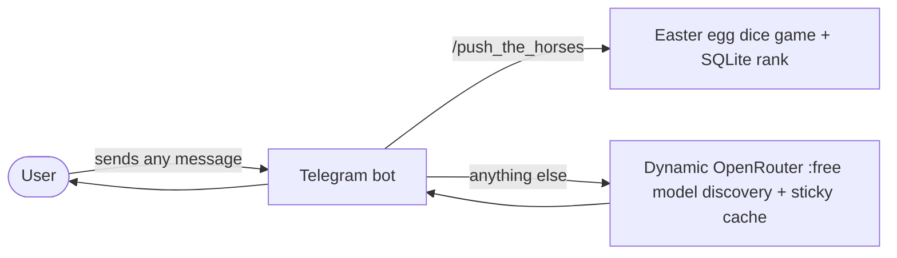

# Mr Prompter — Telegram bullshit bot

Mr Prompter is a Telegram bot that replies to any message (text, photo, file, sticker, voice, or command) with confident, unhinged pseudointellectual conspiracy bullshit generated by free OpenRouter models (`:free`), while keeping the `/push_the_horses` easter egg dice game alive.

## Current architecture



## How free model rotation is handled

Because OpenRouter's free model catalog changes frequently:

1. **Dynamic discovery**: `src/bullshit_engine.py` queries OpenRouter's `/api/v1/models` endpoint (cached for 1 hour) and filters for active zero-cost text chat models (`:free`), skipping safety/guard/moderation classifiers and paid models.
2. **Sticky working model**: Whichever `:free` model succeeds is promoted and reused first on subsequent messages for low latency.
3. **Auto-refresh on rotation**: If a previously working model rate-limits or is retired upstream, the engine automatically steps through other discovered `:free` models (and refreshes `/api/v1/models` if needed), falling back to `openrouter/free` and built-in deadpan lines if all upstream providers fail.

## Commands

| Command | What it does |
|---|---|
| `/push_the_horses` | Run the gamified dice-roll easter egg command |

All other messages and commands receive deadpan pseudointellectual nonsense.

## Quick start

```bash
python3 -m venv .venv
source .venv/bin/activate
pip install -r requirements.txt
cp .env.example .env
```

Set at minimum in `.env`:

- `TELEGRAM_BOT_TOKEN`
- `OPENROUTER_API_KEY` (or `HOST_OPENROUTER_KEY`)

Optional environment variables:

- `OPENROUTER_BASE_URL` (default `https://openrouter.ai/api/v1`)
- `OPENROUTER_MODEL` (optional preferred `:free` model ID; when unset, active `:free` models are discovered dynamically from `/api/v1/models`)

Start the bot:

```bash
chmod +x run_bot.sh
./run_bot.sh
```

## Production

### Systemd

```bash
sudo systemctl status mr-prompter-bot
sudo journalctl -u mr-prompter-bot -f
sudo systemctl restart mr-prompter-bot
```

## Logs

Uncaught errors are logged to `data/logs/errors.log` using a rotating file handler. API keys matching common OpenRouter/Google patterns are redacted from log output.

## Tests

```bash
source .venv/bin/activate
pip install -r requirements-dev.txt
pytest
```
